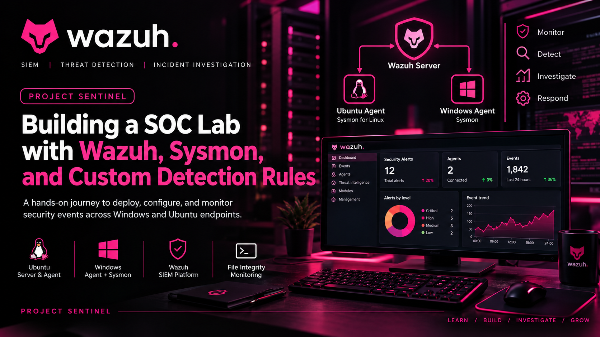

# Project Sentinel: SOC Lab with Wazuh, Sysmon & Custom Detection Rules

**A hands-on Security Operations Center (SOC) lab focused on endpoint monitoring, security event investigation, detection engineering, and file integrity monitoring across Windows and Ubuntu.**



## Overview

Project Sentinel is a virtualized SOC lab I built to develop practical skills in security monitoring, endpoint telemetry collection, event investigation, and custom detection engineering.

Using Wazuh as the central security monitoring platform, I connected Windows and Ubuntu endpoints, enabled archive logging, integrated Sysmon telemetry, investigated Windows account-management activity, developed a custom detection rule, and configured File Integrity Monitoring (FIM) on both operating systems.

The project helped me understand how endpoint events move from collection to centralized analysis, and how security analysts can use those events to investigate activity and identify potentially suspicious changes.

**Project type:** Home SOC Lab  
**Status:** Core lab completed; further detection validation and enhancements planned.

## Objectives

- Deploy and configure Wazuh in a virtualized environment.
- Enable archive logging and configure the archive index pattern.
- Enroll Windows and Ubuntu endpoints as Wazuh agents.
- Integrate Windows Sysmon event collection.
- Explore Sysmon for Linux.
- Investigate Windows user and account-management activity.
- Develop a custom rule for Windows Guest account enablement.
- Configure File Integrity Monitoring on Windows and Ubuntu.
- Build a dashboard for security event monitoring.

## Technology Stack

| Technology | Purpose |
|---|---|
| Wazuh | Centralized security monitoring, event analysis, and alerting |
| Microsoft Sysmon | Detailed Windows endpoint telemetry |
| Sysmon for Linux | Additional Linux system telemetry |
| Filebeat | Processing and forwarding configured Wazuh data |
| Ubuntu Server | Wazuh server environment |
| Windows | Endpoint monitoring and security event investigation |
| VMware Workstation | Virtual machine environment |
| Windows Event Viewer | Reviewing Windows event logs |

## Lab Architecture

The lab consists of a central Wazuh server and two monitored endpoints.

```text
             ┌──────────────────────┐
             │    Wazuh Server      │
             │                      │
             │  Manager             │
             │  Indexer              │
             │  Dashboard            │
             └──────────┬───────────┘
                        │
                Endpoint telemetry
                  and security logs
                        │
             ┌──────────┴───────────┐
             │                      │
    ┌────────▼────────┐   ┌─────────▼────────┐
    │ Windows Endpoint│   │ Ubuntu Endpoint  │
    │                 │   │                  │
    │ Wazuh Agent     │   │ Wazuh Agent      │
    │ Sysmon          │   │ Sysmon for Linux │
    └─────────────────┘   └──────────────────┘
```

The Wazuh agents collect configured endpoint events and forward them to the manager. Wazuh processes the events, applies relevant detection rules, and makes the resulting data available through the monitoring platform.

## Implementation

### 1. Wazuh Deployment

I deployed Wazuh on an Ubuntu Server virtual machine using the all-in-one installation method. I accessed the server remotely through SSH from Windows PowerShell and used the Wazuh dashboard to manage the monitoring environment.

### 2. Archive Logging

I modified the Wazuh manager's `ossec.conf` file to enable archive logging:

```xml
<logall>yes</logall>
<logall_json>yes</logall_json>
```

I restarted the Wazuh manager and configured the Wazuh archives module in Filebeat:

```yaml
filebeat.modules:
  - module: wazuh
    alerts:
      enabled: true
    archives:
      enabled: true
```

After restarting Filebeat, I created the `wazuh-archives-*` index pattern in the dashboard and selected the timestamp field.

This configuration enabled me to explore archived events received and processed by Wazuh, subject to the configured collection sources and indexing pipeline.

### 3. Endpoint Onboarding

I connected Windows and Ubuntu virtual machines to the Wazuh manager using the agent deployment instructions provided by the dashboard.

I followed the appropriate installation and enrollment steps for each operating system and started the agent services.

This established a centralized monitoring environment for investigating activity across both endpoints.

### 4. Windows Sysmon Integration

I installed Microsoft Sysmon on the Windows endpoint using a configuration from [Olaf Hartong's Sysmon configuration repository](https://github.com/olafhartong/sysmon-modular).

I then configured the Wazuh Windows agent to collect the Sysmon Operational event channel:

```xml
<localfile>
    <location>Microsoft-Windows-Sysmon/Operational</location>
    <log_format>eventchannel</log_format>
</localfile>
```

After saving the configuration and restarting the agent service, I used Windows Event Viewer and the Wazuh dashboard to investigate the available event data.

### 5. Sysmon for Linux

I also explored the Linux version of Sysmon on my Ubuntu endpoint and configured it to use a Linux-compatible configuration file.

This extended my learning beyond Windows endpoint monitoring. Windows Sysmon and Sysmon for Linux have different installation and configuration requirements, so each integration must be validated independently.

### 6. Windows Activity Investigation

I generated and investigated Windows system and account-management activity using commands such as:

```cmd
whoami
ipconfig /all
net user
net localgroup administrators
```

In my isolated lab, I also tested account-management operations, including enabling the built-in Guest account, creating a temporary local user, modifying local group membership, and removing the test account.

I used these activities to explore the Windows events available for investigation through Wazuh.

The aim was to understand the relationship between an action performed on an endpoint, the event generated by the operating system, the event collected by the agent, and the alert produced by the monitoring platform.

### 7. Custom Detection Rule

I developed a custom Wazuh rule with ID `100200` to detect Windows Guest account enablement.

The rule matches Windows Security Event ID `4722` and checks whether the target username is `Guest`.

Relevant rule conditions:

```xml
<rule id="100200" level="12">
    <if_sid>60100</if_sid>
    <field name="win.system.eventID">^4722$</field>
    <field name="win.eventdata.targetUserName"
           type="pcre2">^Guest$</field>
    <description>
        MYDFIR-Tosin Windows Guest account was enabled
        (Event ID 4722).
    </description>
</rule>
```

This rule was designed to flag an account-enablement event involving the Guest account for further investigation.

**Detection scope:** This rule targets account enablement. Windows account disablement uses Event ID `4725` and requires separate detection logic if it is to be monitored independently.

A rule configuration demonstrates the intended detection logic; a matching alert is needed to demonstrate successful detection during testing.

### 8. File Integrity Monitoring

I configured File Integrity Monitoring on both Windows and Ubuntu and investigated file-change events in Wazuh.

During testing on Ubuntu, Wazuh recorded a modification to:

```text
/opt/company-data/test.txt
```

The event showed:

- **Agent:** `Maya-ubuntu`
- **Event:** `modified`
- **Description:** `Integrity checksum changed.`
- **Rule ID:** `550`
- **Rule level:** `7`

This demonstrated that Wazuh detected a change to a monitored file on my Ubuntu endpoint.

The Windows FIM configuration and results were also part of the lab.

### 9. Monitoring Dashboard

I built a dashboard in Wazuh to visualize and review security monitoring data.

The dashboard supported my investigation workflow by bringing relevant events and monitoring information into a centralized view.

The value of a security dashboard depends on the data and visualizations it contains. My aim was to make the lab's available telemetry easier to review and investigate.

## Screenshots and Evidence

The screenshots below document key implementation steps and findings. Replace each example path with the corresponding filename in the repository.

### Wazuh Dashboard and Connected Agents


*Windows and Ubuntu endpoints connected to the Wazuh manager.*

### Archive Logging


*Archived Wazuh events available for investigation.*

### Sysmon Telemetry


*Windows Sysmon events collected and displayed in Wazuh.*

### Custom Detection Rule


*Custom rule targeting Windows Guest account enablement.*

### Ubuntu File Integrity Monitoring


*Wazuh detected a modification to `/opt/company-data/test.txt`.*

### Windows File Integrity Monitoring


*File integrity monitoring evidence from the Windows endpoint.*

### Custom Monitoring Dashboard


*Project Sentinel monitoring dashboard.*

## Key Learning Outcomes

Through this project, I gained practical experience with:

- Deploying and configuring a centralized security monitoring platform.
- Configuring archive logging and understanding the event indexing pipeline.
- Enrolling and monitoring Windows and Ubuntu endpoints.
- Collecting Windows Sysmon telemetry through the Wazuh agent.
- Investigating Windows user and account-management activity.
- Writing custom Wazuh detection logic.
- Configuring and testing File Integrity Monitoring.
- Using security event evidence to support investigations.
- Documenting a reproducible security lab.

## Limitations and Future Improvements

This project provides a foundation for further SOC engineering work.

Planned improvements include:

- Expanding the custom detection rule set.
- Validating Guest account enablement and disablement detections separately.
- Testing additional controlled attack-simulation scenarios.
- Improving dashboard visualizations.
- Investigating more Windows and Linux event sources.
- Documenting alert triage, investigation findings, and recommended response actions.
- Verifying end-to-end collection of Linux Sysmon events.

## Related Article

**Medium walkthrough:** *Building a SOC Lab with Wazuh, Sysmon, and Custom Detection Rules*

Add the published Medium article URL here when available.

## Author

**Oluwatosin Adewumi**

Cybersecurity | SOC Analysis | GRC | Detection Engineering

This project was built for educational purposes in an isolated virtual lab. Account-management tests were performed in the lab environment.

---

*Build. Monitor. Investigate. Improve.*# project-sentinel-soc-lab
A hands-on SOC lab using Wazuh, Sysmon, custom detection rules, endpoint monitoring, and File Integrity Monitoring across Windows and Ubuntu.
